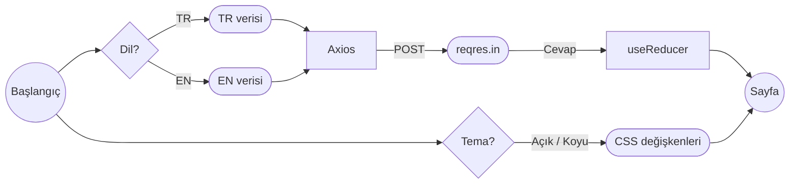

# Sinem's Portfolio

Kişisel portfolyo sitem. Workintech Full Stack Developer programının **S12 Frontend Challenge** projesi olarak React ile geliştirdim.

Site Figma'daki tasarıma birebir uygun olarak hazırlandı. Türkçe ve İngilizce içerik, açık ve koyu tema desteği var, mobil, tablet ve masaüstünde çalışıyor.

## Özellikler

- **Türkçe / İngilizce:** Dil yönetimi i18n paketi kullanmadan, Context API ile yapıldı. Sitenin bütün metinleri tek bir veri dosyasında (`src/data/data.js`) duruyor. Component'lerin içinde sabit metin yok, böylece veri ve görünüm birbirinden ayrı.
- **Açık / koyu tema:** Renkler Figma'dan alınıp CSS değişkenleri olarak tanımlandı. Tema değişince sadece değişkenlerin değeri değişiyor, component'lerde her renk için ayrı bir `dark:` sınıfı gerekmiyor. İlk ziyarette işletim sisteminin tercihi kullanılıyor ve sayfa açılırken beyaz parlama olmuyor.
- **Tercihler hatırlanıyor:** Dil ve tema seçimi `useLocalStorage` hook'u ile tarayıcıda saklanıyor, sayfa yenilense de korunuyor.
- **Dış servis ile iletişim:** Seçili dilin içeriği Axios ile [reqres.in](https://reqres.in)'e POST ediliyor ve sayfada sunucudan dönen cevap gösteriliyor. İsteğin durumu `useReducer` ile tutuluyor. Her dil bir kez isteniyor, aynı dile dönünce yeni istek atılmıyor. Yükleniyor, başarılı ve hata durumları React Toastify ile bildiriliyor. İstek başarısız olursa yerel içerik gösteriliyor.
- **Responsive:** Mobil, tablet ve masaüstü için ayrı düzenler.
- **Performans:** İlk ekrandaki Hero hemen yükleniyor, alttaki bölümler `React.lazy` ile ayrı dosyalara bölünüp sonradan yükleniyor (code splitting). Proje görselleri ekrana yaklaşınca indiriliyor.
- **Erişilebilirlik:** Semantik HTML (`header`, `main`, `section`, `article`, `footer`, `dl`), tema düğmesinde `role="switch"`, ikon linklerinde `aria-label`, klavyeyle gezinirken görünen odak çerçevesi.

## Veri Akışı



1. `LanguageProvider` seçili dili localStorage'dan okur. Kayıt yoksa tarayıcının dilini kullanır.
2. `useContent` hook'u o dilin verisini `data.js`'ten alıp Axios ile reqres'e gönderir.
3. Dönen cevap reducer'a kaydedilir ve context üzerinden bütün component'lere ulaşır.
4. `ThemeProvider` seçili temaya göre `html` etiketine `dark` class'ını ekler, renkler CSS değişkenleri üzerinden değişir.

## Kullanılan Teknolojiler

| Alan | Teknoloji |
| --- | --- |
| Arayüz | React 19, Vite |
| Stil | Tailwind CSS v4 (Figma renkleri tema olarak tanımlı) |
| Global state | Context API, useReducer |
| API | Axios, reqres.in |
| Bildirimler | React Toastify |
| İkonlar | React Icons |

## Proje Yapısı

```
src/
├── api/          # Axios instance ve reqres isteği
├── assets/       # Fotoğraf ve proje görselleri
├── components/   # Header, Hero, Skills, Profile, Projects, ProjectCard, Footer ve küçük yardımcı component'ler
├── context/      # Tema ve dil context'leri, provider'lar
├── data/         # Türkçe ve İngilizce site içeriği
├── hooks/        # useLocalStorage, useTheme, useLanguage, useContent
├── reducers/     # API isteğinin durumu (request / success / failure)
├── App.jsx       # Sayfa düzeni, lazy loading ve bildirimler
└── index.css     # Renkler (açık / koyu), fontlar ve sayfa genişlikleri
```

## Kurulum

```bash
git clone https://github.com/sinembaglar/sinems-portfolio-2.git
cd sinems-portfolio-2
npm install
cp .env.example .env.local
npm run dev
```

`.env.local` dosyasına [reqres.in](https://app.reqres.in/api-keys) üzerinden aldığın API key'i ekle. Uygulama `http://localhost:5173` adresinde açılır.

| Komut | Açıklama |
| --- | --- |
| `npm run dev` | Geliştirme sunucusunu başlatır |
| `npm run build` | Yayın için derler (`dist/` klasörü) |
| `npm run preview` | Derlenmiş sürümü yerelde açar |
| `npm run lint` | Kod kontrolü (oxlint) |

## İletişim

- GitHub: [sinembaglar](https://github.com/sinembaglar)
- LinkedIn: [sinembaglar](https://www.linkedin.com/in/sinembaglar)
- E-posta: sinembglr@gmail.com
